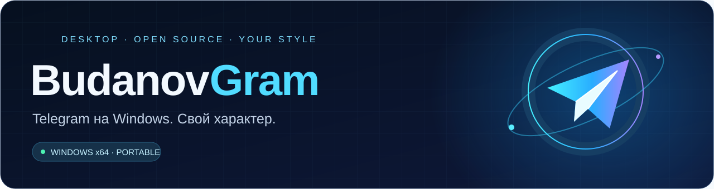
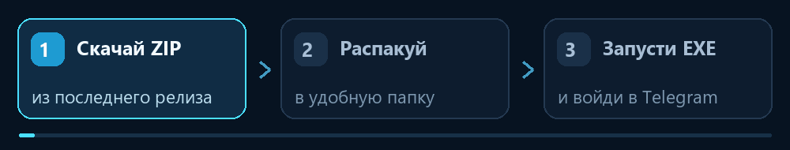

<p align="center">
  
</p>

<p align="center">
  
</p>

<p align="center">
  <strong>Знакомый Telegram. Фирменный стиль BudanovGram.</strong><br>
  Официальный репозиторий BudanovGram — неофициального клиента на основе Telegram Desktop.
</p>

<p align="center">
  <a href="https://github.com/Mengy777/BudanovGram/releases/latest"></a>
  
  
  <a href="LICENSE"></a>
</p>

<p align="center">
  <a href="https://github.com/Mengy777/BudanovGram/releases/latest"></a>
</p>

<p align="center">
  <a href="https://github.com/Mengy777/BudanovGram/releases/latest"><strong>↓ Скачать последнюю версию</strong></a>
  &nbsp; · &nbsp; <a href="#-установка-за-три-шага">Как установить</a>
  &nbsp; · &nbsp; <a href="https://github.com/Mengy777/BudanovGram/releases">Все версии</a>
</p>

---

## 🚀 Установка за три шага

<p align="center">
  
</p>

1. **Скачай.** Нажми [«Скачать последнюю версию»](https://github.com/Mengy777/BudanovGram/releases/latest) и выбери архив `BudanovGram-…-Windows-x64-portable.zip` в разделе **Assets**. Кнопка всегда ведёт к последнему опубликованному релизу.
2. **Распакуй.** Нажми правой кнопкой по архиву → **«Извлечь всё…»**. Выбери удобную папку, например `D:\Programs`. Внутри появится папка `BudanovGram`.
3. **Запусти.** Открой распакованную папку, запусти **`BudanovGram.exe`** и войди в свой Telegram-аккаунт.

> **Для установки не нужны API-ключи, Git, Visual Studio или сборка исходников.** Нужен только ZIP из релиза. Запускай EXE из распакованной папки, а не из архива.

## ✨ Что уже есть

<table>
  <tr>
    <td width="50%"><br><strong>Фирменный стиль</strong><br>Собственная иконка и название BudanovGram в окне и меню клиента.</td>
    <td width="50%"><br><strong>Запуск из папки</strong><br>Portable-версия: распаковал, запустил, вошёл в аккаунт.</td>
  </tr>
  <tr>
    <td><br><strong>Обновления внутри клиента</strong><br>Проверка GitHub Releases, загрузка, проверка пакета и перезапуск.</td>
    <td><br><strong>Открытые исходники</strong><br>Основа — Telegram Desktop. Изменения BudanovGram доступны в этом репозитории.</td>
  </tr>
</table>

**Готовые сборки для Windows x64** — в [GitHub Releases](https://github.com/Mengy777/BudanovGram/releases/latest). Номер актуальной версии отображается на значке вверху страницы автоматически. Тип сборки и изменения указаны в описании релиза.

## 🔄 Как обновляться

**☰ → «О программе» → «Обновить» → «Скачать» → «Установить».**

Ссылка «О программе» находится в самом низу бокового меню, рядом с версией. Если обновление есть, клиент предложит загрузить его и перезапуститься после установки. Данные аккаунтов сохраняются; перед заменой файлов приложения создаётся резервная копия.

<details>
<summary><strong>Обновление вручную</strong></summary>

1. Закрой BudanovGram через **«Выход»** в меню значка возле часов.
2. Сохрани резервную копию своей папки `TelegramForcePortable`.
3. Распакуй новый релиз и замени файлы приложения в прежней папке.
4. **Сохрани свою папку `TelegramForcePortable`** — в ней находятся аккаунты. В архиве релиза эта папка пустая.
5. Запусти `BudanovGram.exe`.

Если в установленной сборке ещё нет работающей кнопки обновления, воспользуйся этим способом для перехода на актуальный релиз.

</details>

## 💬 Частые вопросы

**Нужен новый Telegram-аккаунт?** Нет, войди в свой существующий аккаунт.

**Можно пользоваться рядом с обычным Telegram?** Да, установи BudanovGram в отдельную папку. У portable-версии собственная папка данных.

**Где хранятся аккаунты?** В папке `TelegramForcePortable` рядом с приложением. Не отправляй её другим людям и не публикуй в GitHub.

**Как создать ярлык на рабочем столе?** Нажми правой кнопкой по `BudanovGram.exe` → **«Отправить» → «Рабочий стол (создать ярлык)»**. В Windows 11 сначала может понадобиться **«Показать дополнительные параметры»**.

**Где установщик Setup.exe?** Пока распространяется portable-архив ZIP. Отдельного установщика ещё нет.

**Есть версия для Android?** Пока нет. Android-версия запланирована; APK в текущих релизах отсутствует.

**Есть режим призрака или дополнительные Premium-функции?** О доступных возможностях читай в разделе выше и в описании [последнего релиза](https://github.com/Mengy777/BudanovGram/releases/latest). Планы развития не означают, что функция уже реализована.

## 🛠 Для разработчиков

Чтобы просто установить клиент, используй [готовую сборку](https://github.com/Mengy777/BudanovGram/releases/latest). Этот раздел нужен для самостоятельной сборки и разработки.

```sh
git clone --recursive https://github.com/Mengy777/BudanovGram.git tdesktop
```

[Инструкция сборки Windows →](budanovgram/README-RU.md)

Собственные Telegram `api_id` и `api_hash` нужны только при сборке. Файл `build-secrets.json`, каталог `out` и данные аккаунтов должны оставаться локальными.

Нашёл ошибку? [Создай issue](https://github.com/Mengy777/BudanovGram/issues/new) и укажи версию клиента, Windows и шаги воспроизведения. Не прикладывай данные аккаунтов или API-ключи.

---

<p align="center">
  <strong>BudanovGram</strong><br>
  Создатель: @Putin_Ebanoe_Huilo<br>
  <a href="https://github.com/Mengy777/BudanovGram/releases">Скачать</a> · <a href="https://github.com/Mengy777/BudanovGram/issues">Сообщить об ошибке</a> · <a href="LICENSE">Лицензия</a>
</p>

Основан на [Telegram Desktop](https://github.com/telegramdesktop/tdesktop). BudanovGram не является официальным клиентом Telegram. Сохранены [исходное описание проекта](README.upstream.md), [LICENSE](LICENSE) и [LEGAL](LEGAL); лицензия GPL v3 с исключением OpenSSL.
